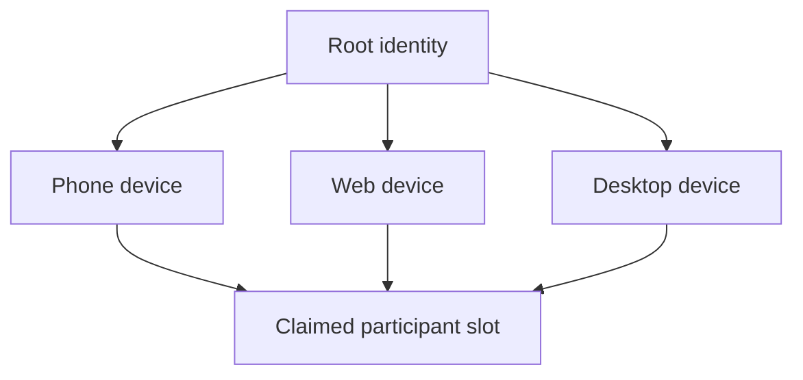
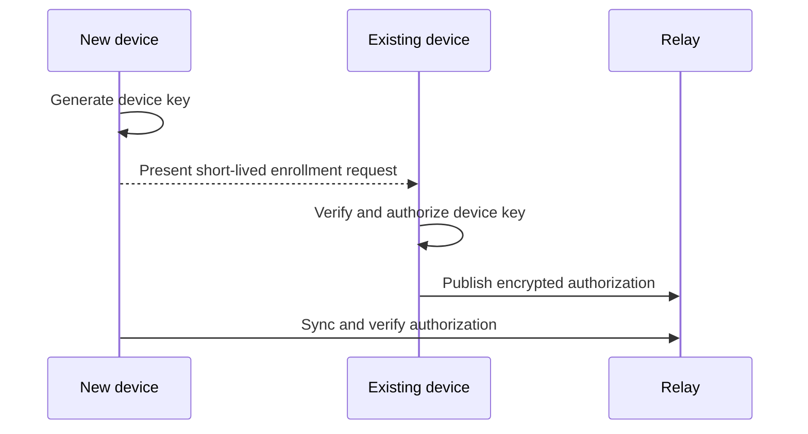

# Multi-device identity

One person may authorize multiple device keys under one root identity. Participant slots bind to the root identity, while ordinary operations are signed by authorized devices.

## Current file transfer

Password-encrypted file transfer copies the root identity, per-group relay capabilities and encryption secrets, and each group's complete locally retained signed operation history. Transfer format version 3 carries protocol-v2 operations. Access-only exports are superseded; generate a fresh export from the source device.

If the source session is gone, the [standalone recovery tool](../identity-export-recovery.md) can turn an older access-only export and available relay history into a new version 3 file. The app continues to import only version 3.

Import validates the root key pair, device ownership, all operation signatures and authorization, group IDs, participant ownership, directory records, and access schemas before replacing local data. Identity, device, group histories, access, and directory records are replaced in one IndexedDB transaction. The receiving session creates a fresh device key and signs its authorization locally with the transferred root. Groups are visible and editable without a relay; the source session remains usable. Reconnect synchronization exchanges both sessions' encrypted operation sets, including device authorization and revocation.

Group enumeration includes access-only records so missing history can be retried. A new export fails if required owned-group history or access is missing instead of silently exporting fewer groups. Unclaimed invitation previews are excluded from identity exports.

Current limitations:

- The offline file is a snapshot; subsequent discovery and updates require connectivity to the identity directory relay and the relevant group relay. When history is missing, another sufficiently complete member must come online.
- Import replaces the receiving session's identity and local groups. Pre-release storage is reset when its schema changes; no legacy storage or transfer-format migration is supported.
- Root keys are copied by this portability flow. Device-key revocation does not revoke possession of an exported root key or erase downloaded history and secrets. A hostile root-key holder can authorize another device; stronger root-isolated enrollment remains target work.

## Automatic discovery and device registry

Each identity owns a randomly generated, capability-protected relay namespace and an independent encryption secret. Its access material is persisted with the identity and included in the encrypted transfer. It is not a participant group and never appears in the dashboard. The selected relay at identity creation hosts this directory; changing the relay preference affects new product groups, while enrolled devices retain their shared directory endpoint.

The directory is an append-only set of domain-separated, root-signed records:

| Record | Purpose |
|---|---|
| `GroupShared` | Group access, encryption material, and advisory group name for an owned claimed slot |
| `DeviceRegistered` | Device public key and advisory name |
| `DeviceRevoked` | Permanent identity-wide device-key revocation |

All records are encrypted before publication. Record IDs hash their canonical signed body and bind it to the identity and directory namespace. Import and network reads verify the root signature, hash, namespace, schemas, and conflicting group access before persistence. Duplicate records are idempotent; revocation wins over device registration regardless of arrival order. These records use the existing opaque relay envelope API without exposing plaintext membership or keys to the relay.

On startup, reconnect, return to the foreground, and the periodic sync interval, the client:

1. Registers its device and advertises locally retained owned groups.
2. Fetches, validates, merges, and republishes the retained directory record set.
3. Stores newly discovered group access unless the group was explicitly deleted locally or the current device is revoked.
4. Synchronizes known groups independently, validates their history, and authorizes the current fresh device only when its root still owns an active slot and its device key has not been revoked.
5. Materializes identity-wide revocations as owner-signed group revocations, including groups that were unknown when the owner clicked Revoke.
6. Refreshes group and device UI from durable state, including named groups awaiting history.

Local commands also request synchronization, with a follow-up round when another command arrives during an existing round. A failed directory relay does not block synchronization or offline use of already known groups. Future groups appear automatically after successful directory and group synchronization; another file transfer is unnecessary.

Explicit local group deletion records a local suppression marker. Directory republication cannot resurrect the deleted group on that device. Other devices retain the group. Importing a fresh identity snapshot clears local suppression markers.

## Anti-entropy and lifecycle

Synchronization fetches and merges remote records, republishes every retained local operation, and performs a second read before disconnecting. Missing parents do not skip publication; one complete member can therefore heal a pruned or empty relay. The second read validates responses and detects relay publication errors or dropped writes instead of treating a WebSocket send as confirmed storage. A malicious relay can still delay, omit, replay, or reorder ciphertext even when it cannot forge valid operations.

Handshake and request deadlines bound unavailable relays. Connection closure rejects pending work; disconnected writes fail; pagination must advance. Import, identity deletion, and local group deletion wait for in-flight synchronization before replacing or removing state, preventing old responses from repopulating deleted data.

## Target enrollment

Enrollment tokens are short-lived, single-use, and scoped to one identity. They are not participant invitations.

## Revocation

Revocation prevents future operations by that device according to causal authorization rules. Normal group administration and revocation in the web client use the current device key, so a revoked session cannot bypass the revocation by signing ordinary administrative actions with the root key. A revoked key is never automatically reauthorized by background synchronization. Identity-wide revocations are saved in the local directory and retried through reconnect synchronization when the relay is unavailable. The application blocks further normal commands and automatic discovery/enrollment by that device after learning the revocation. It cannot erase operations validly signed before revocation, and an offline peer cannot know about revocation until synchronization.

## Platform behavior

- Web devices store identity material through the web adapter and may be lost when site data is cleared.
- Tauri devices store private material through OS-backed facilities.
- Device names and last-seen information are advisory metadata, not authorization proof.
- No device is automatically trusted because it shares a display name.
