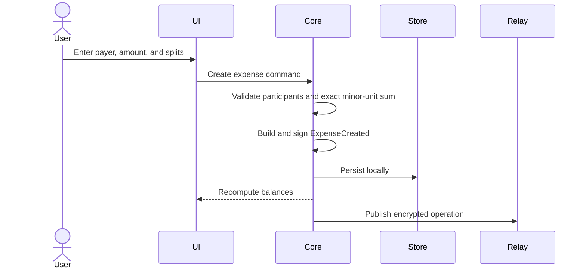

# Expense creation and editing

Participants may be claimed or unclaimed active slots. Expenses use stable participant IDs.

For a custom split, the form divides the remaining amount evenly among included participants whose shares have not been edited. Manually entered shares stay fixed while other shares adjust. Excluded participants have zero shares. If the remaining fields cannot absorb the difference, the form requires the user to bring the split total back to the expense amount before saving.

## Editing

An edit creates one immutable `ExpenseCorrected` operation with complete replacement data. A deletion creates `ExpenseVoided`. Balances and totals use the deterministic effective expense. The group view shows totals by currency and sorts expenses by their original creation time, newest first by default. It also offers oldest first and grouping by payer.

## Invariants

- Amounts use integer minor units and are positive.
- Splits are non-negative and sum exactly to the amount.
- Payer and split participants exist and are active in the relevant causal state.
- Concurrent corrections follow the protocol's documented deterministic rule.
- Balance sum remains zero.
